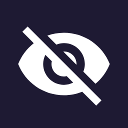
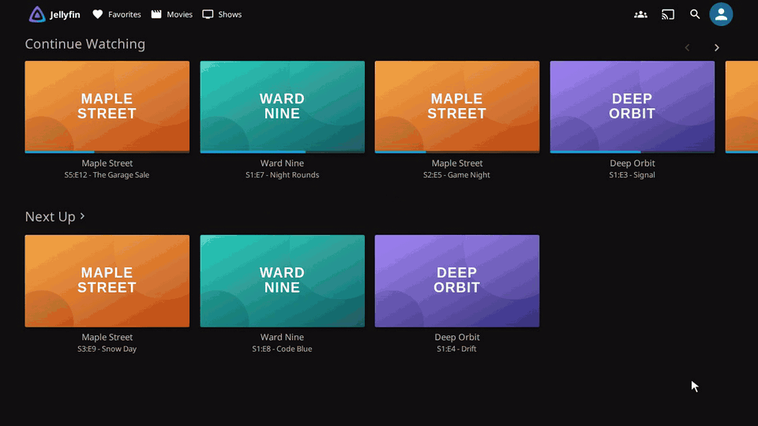
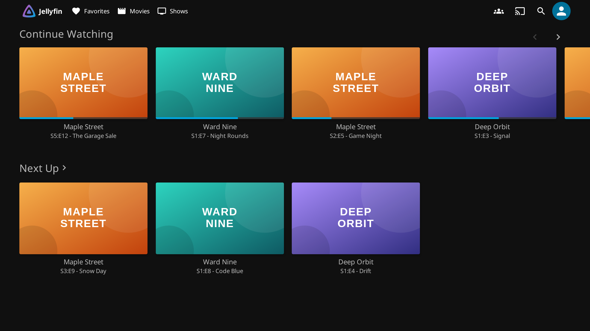
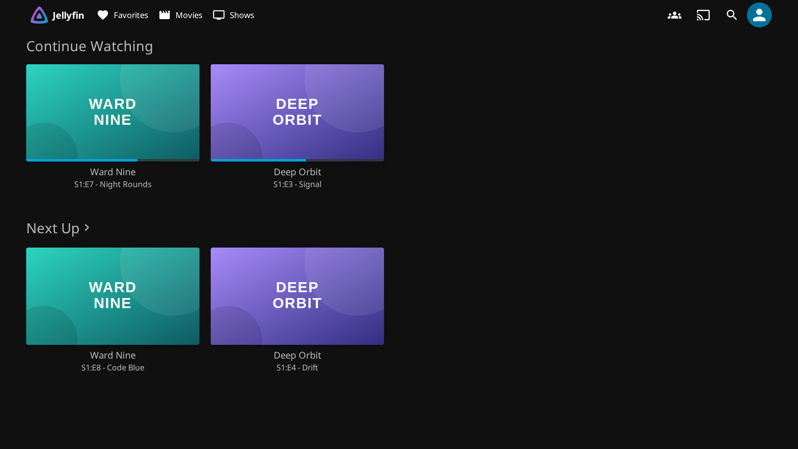
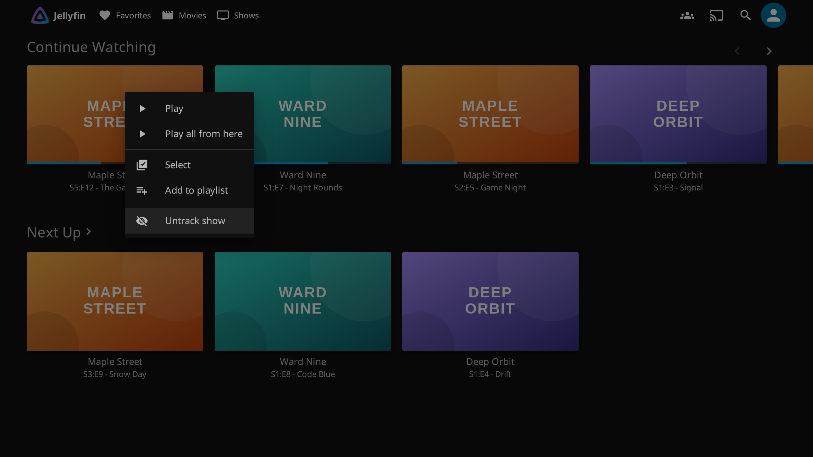
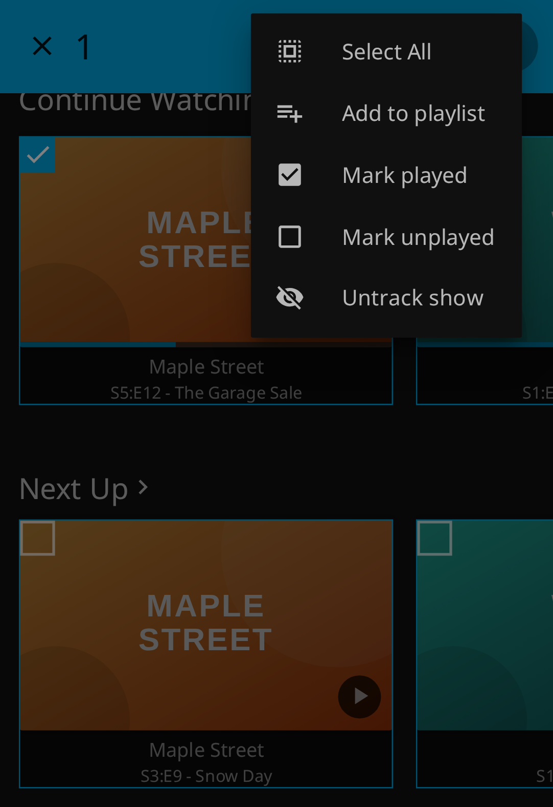

<div align="center">



# Untrack Show

**One click. Whole show gone.** Clear a show out of Continue Watching *and*
Next Up from Jellyfin's ⋮ menu.

[](https://github.com/bmuraykhi/jellyfin-plugin-untrack/releases/latest)
[](LICENSE)

</div>

Watched a few random episodes of a sitcom and now it's all over **Continue Watching** and **Next Up**? This plugin
adds **Untrack show** to the ⋮ menu. One click and the whole show leaves both rows.



## Why

Jumping into a long-running show at random leaves resume points across several seasons. Each one becomes its own
Continue Watching card, and Next Up keeps offering "the next episode" of whatever you watched last. Jellyfin has no
button to drop a whole show from these rows. Fixing it by hand means finding and resetting episodes one at a time,
and marking an episode played only moves the show into Next Up.

**Untrack show** resets the whole show for you in one step, so it disappears from both rows until you start
watching it again.

| Before | After |
| :---: | :---: |
|  |  |
| Maple Street takes three of the five Continue Watching cards and also sits in Next Up. | One click later, only the shows you're really watching are left. |

## Requirements

- Jellyfin **12.4**
- The **[File Transformation](https://github.com/IAmParadox27/jellyfin-plugin-file-transformation)** plugin, which
  lets plugins add to the web interface without editing its files. Install it from its catalog: add
  `https://www.iamparadox.dev/jellyfin/plugins/manifest.json` under Dashboard → Plugins → **Manage Repositories**,
  then install **File Transformation** from the catalog and restart.

## Install

One-time setup. After this, updates arrive from the catalog like any other plugin.

1. Dashboard → **Plugins** → **Manage Repositories** → **+**
2. Name: `Bandar's plugins` (any name works)
3. URL:

   ```
   https://raw.githubusercontent.com/bmuraykhi/jellyfin-plugins/main/manifest.json
   ```

   It's the catalog for all my plugins, including
   [Season Subtitle Downloader](https://github.com/bmuraykhi/Sub-Jellyfin). If you have the older Sub-Jellyfin
   catalog URL, replace it with this one.
4. Save, then Dashboard → **Plugins** → **Catalog** → **Untrack Show** (under *General*) → **Install**
5. Restart Jellyfin, then reload the web page (or fully close and reopen the app)

You're set when the ⋮ menu of an episode shows **Untrack show**.

## How to use it

**On a computer** (web browser or Jellyfin desktop app): hover a show's card, click **⋮**, then **Untrack show**.



**On a phone** (Jellyfin app or mobile browser): cards don't have a ⋮ there, so **long-press** the card, tap
**⋮** at the top right, then **Untrack show**. Select several cards first to untrack several shows at once
("Untrack 3 shows").



**From a show, season or episode page:** the page's **⋮** button has **Untrack show** too.

After the option is used you'll see "Untracked *show name*" and the page refreshes with the updated rows.

## Good to know

- **It resets your progress for that show.** Untracking marks every episode of the show unwatched and clears resume
  points. That's what keeps it out of Next Up. It only affects the signed-in user; other people on the server keep
  their progress.
- **To bring a show back,** just play any episode of it.
- **Cleanup tools see it as unwatched.** If you run something that deletes media nobody has watched (for example
  Maintainerr rules on "watched" status), an untracked show counts as unwatched.

## Where it works

The option is added to Jellyfin's web interface, so it appears in every client that shows that interface:

| Client | Untrack show |
| --- | :---: |
| Web browsers (desktop and mobile) | ✅ |
| Jellyfin Media Player / Jellyfin desktop app | ✅ |
| Jellyfin for Android and Jellyfin for iOS (the official phone apps) | ✅ |
| Android TV, Fire TV, Swiftfin, Roku and other native TV apps | ❌ |

Native TV apps draw their own menus, which plugins can't add to. Untracking a show from any supported client also
clears it on the TV, because the change is stored on the server.

## Uninstall

Dashboard → Plugins → My Plugins → **Untrack Show** → **Uninstall**, then restart. Shows you already untracked stay
as they are.

<details>
<summary><b>Manual install</b> — only if Jellyfin can't reach GitHub, or you want a specific older build</summary>

&nbsp;

You'll have to repeat this for every update.

1. Download `untrack-show.zip` from the
   [latest release](https://github.com/bmuraykhi/jellyfin-plugin-untrack/releases/latest) and unzip it. You'll get
   `Jellyfin.Plugin.UntrackShow.dll`, `meta.json` and `icon.png`.
2. Copy all three into a folder named `Untrack Show_<version>` (e.g. `Untrack Show_1.0.2.0`) in Jellyfin's plugins
   directory:

   | Install type | Plugins path |
   | --- | --- |
   | Linux (systemd) | `/var/lib/jellyfin/plugins/` |
   | Docker | `/config/plugins/` *(inside the container)* |
   | Windows | `%ProgramData%\Jellyfin\Server\plugins\` |
   | macOS | `~/.local/share/jellyfin/plugins/` |

3. Make sure Jellyfin can read them (`chown jellyfin:jellyfin` on Linux, or match `PUID:PGID` on Docker), then
   restart.

</details>

<details>
<summary><b>Build from source</b></summary>

&nbsp;

Requires the .NET 10 SDK, or Docker:

```sh
dotnet publish -c Release -o bin/publish

# or, without installing .NET:
docker run --rm --user "$(id -u):$(id -g)" -e HOME=/tmp -v "$PWD":/src -w /src \
    mcr.microsoft.com/dotnet/sdk:10.0 dotnet publish -c Release -o /src/bin/publish
```

The DLL lands in `bin/publish/`; `meta.json` is in the repository root and `icon.png` in `assets/`. Copy all three
into a plugin folder as described under **Manual install**.

**For another Jellyfin version:** set the `Jellyfin.Controller`, `Jellyfin.Model` and `Jellyfin.Common` package
versions in `Jellyfin.Plugin.UntrackShow.csproj` to your server's version, and `targetAbi` in `meta.json` to match.

</details>

## How it works

- **On the server**, the plugin asks File Transformation to add one `<script>` tag to the web interface's
  `index.html`, and serves that script at `/UntrackShow/script`. It has no settings and stores nothing.
- **In the browser**, the script watches for Jellyfin's ⋮ menus. When one opens for an episode, season or show
  (or for a multi-select of them), it looks up the show and adds **Untrack show**.
- **Untracking** calls Jellyfin's own API, `DELETE /UserPlayedItems/{seriesId}` for the signed-in user: the same as
  marking the whole show unplayed. The script then clears the web interface's cached copy of the home rows and
  reloads the page so the rows update right away.

The script only talks to your Jellyfin server.

| Path | What it is |
| --- | --- |
| `Plugin.cs` | Plugin entry point (name, id, description) |
| `StartupTask.cs` | Registers the `index.html` change with File Transformation at startup |
| `Transformations.cs` | Adds the script tag to `index.html` |
| `UntrackShowController.cs` | Serves the script at `/UntrackShow/script` |
| `Web/untrack.js` | The menu option and the untrack logic (runs in the browser) |
| `meta.json`, `assets/icon.png` | Plugin manifest and icon, shipped in the release zip |
| `test/ui_test.py` | End-to-end browser test; also makes the images in `docs/images` |

## Testing

`test/ui_test.py` loads the real web interface from a Jellyfin server that has the plugin installed, in a headless
browser, and checks the menu on desktop, on a phone layout, in multi-select and on an episode page, then untracks a
show and checks that it leaves both rows. The shows it uses (Maple Street, Ward Nine, Deep Orbit) are made up: the
test answers those requests itself, so it works with any library and doesn't change anyone's watch history. It needs
a signed-in user's session; the variables are described at the top of the file.

## License

The Unlicense (public domain) — see [LICENSE](LICENSE).

That covers this repository's own source. The released plugin links against Jellyfin's GPL-3.0
`Jellyfin.Controller` and `Jellyfin.Model` assemblies, so the compiled DLL and the release zip are a combined work
under the GPL-3.0. Reuse the source freely; redistributing the built plugin carries the GPL's terms.
